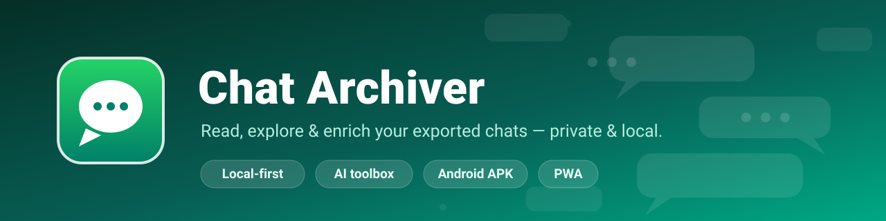
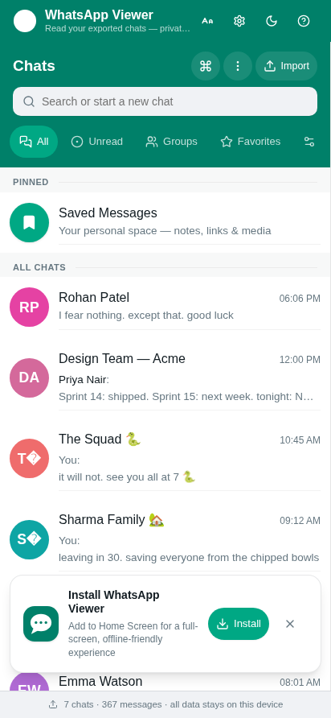
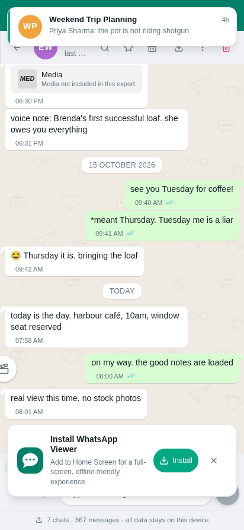
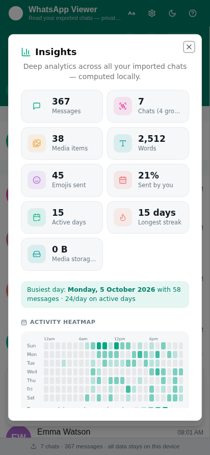
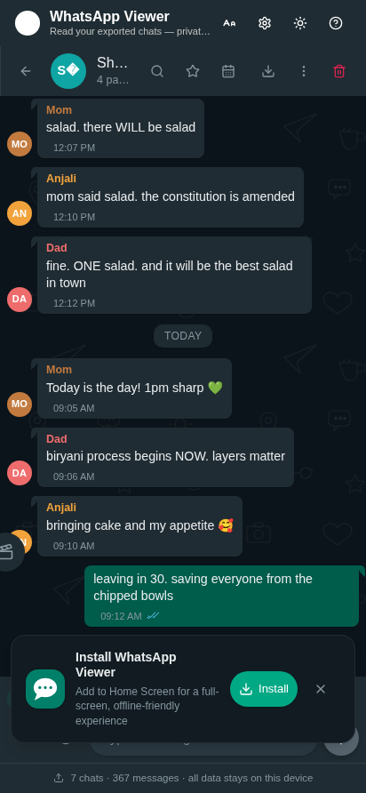

<div align="center">



[](https://github.com/Avithegod2010/WA-archiver/releases/latest)
[](https://github.com/Avithegod2010/WA-archiver/actions/workflows/android-apk.yml)
[](LICENSE)
[](#-android-app-offline-apk)
[](https://nextjs.org)
[](#-contributing)
[](https://avithegod2010.github.io/WA-archiver/app/)
<!-- Google Play badge — uncomment once the Play listing is live and set the
     real package URL. The app-side button flips on via PLAY_LISTING_URL in
     src/lib/version.ts.
[](https://play.google.com/store/apps/details?id=io.github.avithegod2010.waarchiver)
-->


**Turn your exported WhatsApp chats into a beautiful, private chat experience —
with AI superpowers, voice notes, reactions, stats and an app lock.**

No account · No cloud · No tracking · Your data never leaves your device

<div align="center">

### 🌐 **[→ OPEN THE WEB APP: avithegod2010.github.io/WA-archiver/app ←](https://avithegod2010.github.io/WA-archiver/app/)**

*The full app, live on GitHub Pages — nothing to install, nothing to configure.*

</div>

[**Web app**](https://avithegod2010.github.io/WA-archiver/app/) · [Features](#-features) · [Quick start](#-quick-start) · [**User guide**](docs/user-guide.md) · [Android app](#-android-app-offline-apk) · [Host it yourself](docs/hosting.md) · [Privacy](#-privacy-model) · [Policy](PRIVACY.md) · [FAQ](#-faq) · [Roadmap](#-roadmap)

</div>

---

## 🤔 What is this?

Three bullet points, honestly:

- 📥 **You export** — In WhatsApp, open a chat → `⋮ → More → Export chat → with media`. You get a `.zip` (or `.txt`).
- 💬 **You drop it in** — WA Archiver reads the export and shows it in a familiar, polished chat interface: bubbles, replies, reactions, photos, voice notes, documents, locations.
- 🔒 **It stays yours** — Everything is stored in a local SQLite database on your own device. No server, no login, no analytics. Optional AI features use *your own* key and talk straight to Google.

> 💡 **No export at hand?** Click **Try demo chats** on first launch and explore a
> fully-populated app in one second — no import needed.

## 📸 Screenshots

| | |
|---|---|
|  |  |
|  |  |

*Chat list · chat view with voice notes & media · cross-chat Insights dashboard · dark mode.*

> 📖 **Step-by-step help** — exporting from WhatsApp (Android/iOS), importing,
> troubleshooting and device migration live in the [User guide](docs/user-guide.md).

---

## ✨ Features

| | Category | Highlights |
|---|---|---|
| 💬 | **Reading** | Authentic chat UI · day separators · replies · reactions · starred messages · unread divider |
| 🖼️ | **Media** | Photos, videos, documents, locations, contact cards · lightbox viewer · media gallery grid · media ZIP export |
| 🎙️ | **Voice notes** | Waveform player · speed control · floating mini-player across chats · **on-device transcription** (offline Whisper) |
| 🔍 | **Finding** | Global search (`Ctrl+K`) · per-chat search with date/starred/regex filters · **heat-dot activity calendar & date-range explorer** · **bookmarks** · word cloud |
| 📊 | **Understanding** | Cross-chat Insights dashboard · per-chat stats · **Year in Review rewind** · storage breakdown · "On this day" memories |
| ✍️ | **Messaging** | Send messages, photos, audio, docs & polls · scheduled messages · simulated replies in demo chats |
| 🤖 | **AI toolbox** | Translate · explain slang & context · ask AI about the chat · chat TL;DR · AI-generated wallpapers |
| 🔐 | **Privacy** | Server-verified **PIN App Lock** (4–8 digits) · local SQLite storage · nothing phones home |
| 📦 | **Getting data out** | Export to `.txt` / `.zip` / standalone offline `.html` · full JSON backup · print |
| 📱 | **Experience** | Installable PWA · **17 themes with matched light/dark palettes** · bubble styles & density · wallpapers studio · text size & font settings · keyboard shortcuts |

<details>
<summary><b>🗒️ The full feature list</b> (click to expand)</summary>

- Import one or many exports (`.zip` with media, or `.txt`) — with preview before import
- Telegram-style floating mini-player that keeps audio playing across chats
- Unread badge + unread divider with "jump to first unread"
- Timeline scrubber and jump-to-date popover
- Chat folders, pins, archive and swipe actions
- One-second hover quick-actions: reply, react, forward, star, copy
- Long-press a message → **Speak** (text-to-speech), translate, explain
- Scheduled messages — compose now, deliver later
- Simulated replies in demo chats (AI or offline personas)
- Message editing safety, message deletion, forward with multi-select
- Word cloud per chat, cross-chat Insights dashboard
- "On this day" memories
- Backup reminders (gentle nudges, no nagging)
- Data & storage dashboard — see exactly what each chat uses
- Custom chat wallpapers (built-in gradients or AI-generated)
- Adjustable text size and font family
- Keyboard shortcuts + printable shortcut sheet

</details>

---

## 🌐 Use it without installing anything

The full app runs in your browser, free, thanks to GitHub Pages:

**[avithegod2010.github.io/WA-archiver/app](https://avithegod2010.github.io/WA-archiver/app/)**

Same local-first behavior as the APK — your chats live in your browser's
own storage and never touch a server. Installable as a PWA (share-target
included), or self-host it: see **[docs/hosting.md](docs/hosting.md)**
(GitHub Pages · Vercel · any static host). Store-submission status
(IzzyOnDroid ✅ / F-Droid roadmap) lives in
**[docs/launch-checklist.md](docs/launch-checklist.md)**.

## 🚀 Quick start

**Prerequisites:** [Node.js 20+](https://nodejs.org) and [Bun](https://bun.sh)
(npm/pnpm work too — the scripts are runner-agnostic).

```bash
# 1. Clone & install
git clone https://github.com/Avithegod2010/WA-archiver.git WA-archiver
cd wa-archiver
bun install

# 2. Create your env file
cp .env.example .env

# 3. Create the database
bun run db:push

# 4. Start the app
bun run dev
```

Open **http://localhost:3000** → click **Try demo chats** to explore instantly.
To use your own chats, export them from WhatsApp (`⋮ → More → Export chat → with media`)
and drop the `.zip` into the import panel.

> ⚡ **Don't want to run a server?** Grab the [Android APK](#-android-app-offline-apk) —
> the entire app ships inside it and works fully offline.

---

## 📱 Android app (offline APK)

The whole app — UI, on-device SQLite, search, stats, lock, backups — is bundled
into a single installable APK. **No internet required, ever** (AI tools are the
only optional online bits).

**📥 Download:** Go to the [**Releases**](https://github.com/Avithegod2010/WA-archiver/releases) page →

| Release | What you get |
|---|---|
| **Versioned** (e.g. `v1.0.1`) | Stable build for that release, APK attached as an asset |
| **`latest`** (rolling pre-release) | Auto-built APK from the newest `main` commit, refreshed on every push |

Then on your phone: open the APK → allow *"install from unknown sources"* when
prompted → done. Voice-note transcription runs on the phone itself (on-device
Whisper, one-time ~45 MB model download in Settings → AI) — it works in
airplane mode.

<details>
<summary><b>Building it yourself</b></summary>

```bash
bun run build:capacitor   # static-exports the app into capacitor-web/
bunx cap sync android     # copies web assets + config into the Android shell
cd android && ./gradlew assembleDebug
# → android/app/build/outputs/apk/debug/app-debug.apk
```

CI does the same thing automatically — see
[`.github/workflows/android-apk.yml`](.github/workflows/android-apk.yml).

</details>

---

## 🧠 AI features (optional)

The AI toolbox is **bring-your-own-key**: paste a free
[Gemini API key](https://aistudio.google.com/apikey) in *Settings → AI* and
requests go **directly from your device to Google** — never through any
intermediary server. No key? Everything else keeps working.

| Tool | What it does |
|---|---|
| Translate | Any message, any language |
| Explain | Slang, context, tone — handy for old chats |
| Ask AI | Chat-grounded Q&A ("where did we decide on X?") |
| Summarize | TL;DR of long chats |
| Wallpapers | Generate a custom chat wallpaper |

---

## 🔒 Privacy model

- Chats, media and settings live in a local SQLite database (`db/` on server
  installs, OPFS-persisted SQLite on the Android app).
- **Zero telemetry.** The app makes exactly two kinds of network calls: the AI
  actions you explicitly trigger, and link previews — both optional.
- App Lock is a 4–8 digit PIN verified server-side (your machine) with an
  httpOnly cookie session.
- Security policy: see [docs/SECURITY.md](docs/SECURITY.md) and
  [docs/offline-architecture.md](docs/offline-architecture.md) for the design decisions.

---

## 🧱 Tech stack

| Layer | Choice |
|---|---|
| Framework | Next.js 16 (App Router) + TypeScript |
| UI | Tailwind CSS 4 + shadcn/ui (New York) + Lucide icons |
| Database | Prisma ORM + SQLite (server) · SQLite WASM/OPFS (device) |
| Android | Capacitor shell, Gradle debug builds via GitHub Actions |
| AI | Gemini (user key) — translate, explain, ask, summarize, TTS, ASR, wallpapers |

---

## 🌿 Branches

| Branch | Purpose |
|---|---|
| `main` | Release line — stable, tagged releases, APK builds |
| `stable` | Mirror of the latest release for pinning |
| `beta` | Active development — may be bumpy |

---

## 🗺️ Roadmap

- [x] ~~Personalization: 17 themes, bubble styles, wallpapers~~ *(v1.1)*
- [x] ~~Year in Review, date-range explorer, bookmarks~~ *(v1.1)*
- [x] ~~Custom accent color & appearance (auto/light/dark)~~ *(v1.1)*
- [x] ~~Media Hub: search, favorites, date-range filter, shared albums~~ *(v1.7)*
- [x] ~~Multi-language UI (i18n): English, हिन्दी, اردو, मराठी, தமிழ்~~ *(v1.6)*
- [x] ~~CSV export for chats & starred messages~~ *(v1.7)*
- [x] ~~Play Store App Bundle (.aab) + per-ABI APKs + in-app update checker~~ *(v1.7)*
- [x] ~~Year-in-review share cards (PNG)~~ *(v1.6)*
- [x] ~~Encrypted backups — optional passphrase (AES-GCM) on JSON backups~~ *(v1.8)*
- [x] ~~Smart collections: Media / Active this week / Biggest~~ *(v1.8)*
- [x] ~~Per-chat themes (17 themes, scoped to one chat)~~ *(v1.8)*
- [x] ~~Message editing / unsend with "edited" tags~~ *(v1.8)*
- [x] ~~Export round-trip: location, contact, poll, deleted + scheduled sends~~ *(v1.8.1)*
- [x] ~~Cloud-ready persistence: WebDAV / Google Drive / S3 sync, auto-push, snapshot history (all E2EE)~~ *(v1.8–1.8.1)*
- [ ] One-bundle multi-device transfer

---

## ❓ FAQ

**Is my data uploaded anywhere?**
No. Imports are parsed on your machine and stored in a local database. The only
optional network calls are AI features (your key → Google) and link previews.

**Do I need a Gemini API key?**
No — it's optional. Without a key, everything except the AI toolbox works fully
offline.

**Is this affiliated with WhatsApp or Meta?**
**No.** WA Archiver is an independent, open-source tool that reads export
files produced by WhatsApp. It is not endorsed by, affiliated with, or connected
to WhatsApp LLC or Meta Platforms in any way. *WhatsApp* is a trademark of its
respective owner.

**Are the APK builds signed?**
Yes — every `v*` tag triggers a signed release APK in GitHub Actions
(see [Releases](https://github.com/Avithegod2010/WA-archiver/releases));
pushes to `main` publish a rolling pre-release build.

**Does it work on iPhone?**
Not as an app — iOS doesn't allow sideloading APKs. The PWA runs in any mobile
browser, though, and the full Android APK works on any Android 8+ phone.

---

## 🤝 Contributing

Issues and PRs are welcome! For big changes, open an issue first so we can align
on direction. Feature ideas live in the issue tracker.

## 📄 License

[MIT](LICENSE) — free to use, modify and share.
